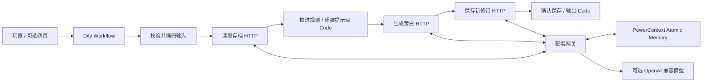

# 第七站失物招领

一个会记得玩家的 AI 车站。把「会下雨的伞」或「星期八的闹钟」交给站长，换一张只会指向昨天的车票；换一节车厢，站长仍记得你上次的失物。归还失物、恶作剧和登上末班车，会走向不同结局。

本目录是 **Just for Fun——用 Dify 做一个好玩的智能应用** 的完整提交，基于赛事 `2026-competition-ecosystem` 分支。唯一必需导入文件为 [`station7.yml`](station7.yml)。所有自定义代码与素材均为本作品原创。

## 实际分工



- **Dify 是唯一游戏入口及核心编排器**：9 个节点承担输入校验、规则分支、状态推进、模型提示词组装、HTTP 调用和输出校验。网页只调用 Dify 的 `/v1/workflows/run`。后端没有替代 Dify 的玩法入口。
- **PowerContext 1.4.1** 持久化玩家藏品、信任、最近四次互动、结局和最后一次请求。每个存档口令映射一个稳定 Scope，游戏状态保存在同一个 `atomic-memory` Artifact 的连续修订中。采用真实 HTTP 接口及 `ETag / If-Match` 条件更新。网关重启后仍从 PowerContext 读取，不靠会话历史或进程缓存恢复剧情。
- **模型**只创作旁白，不能修改状态或选择 Scope。Dify 先计算确定的事件和结局，再组装模型上下文。配套服务通过 OpenAI 兼容接口请求模型，因此**无需任何 Dify 模型插件**。
- **未使用 seekdb**。PowerContext 的底层存储是 SQLite；题目允许仅使用 PowerContext。Dify 本身使用 PostgreSQL / Redis，不能把这两者误称为 seekdb。

## 运行环境

建议 Linux x86_64，或 Windows Docker Desktop / WSL2。Docker Engine 24+、Compose v2，至少 4 GB 可用内存、8 GB 可用磁盘，能访问 Docker Hub 和 PyPI。首次拉取镜像需要网络。Python 原生运行要求 3.11+。

固定的主要版本：Dify **1.9.1**、Dify Sandbox **0.2.12**、PowerContext **1.4.1**、Python **3.11.14**、httpx **0.28.1**、PyYAML **6.0.3**。无知识库、Embedding、Rerank、自定义插件和外部数据依赖；首次行动创建初始存档。空白实例不需要导入作者的数据。

### 1. 生成配置并启动

在仓库 `dify/` 中运行：

```bash
python scripts/configure.py
docker compose up -d --build
docker compose logs -f dify-api powercontext gateway
```

`configure.py` 为 `.env` 生成本地随机令牌，不会打印它们，也不会覆盖已有 `.env`。不要把 `.env` 或真实密钥提交到仓库。

Windows 直接在 WSL 中运行 Docker 时，请保持 WSL 终端开启；也可前台运行 `docker compose up` 查看日志。Docker Desktop 用户保持 Docker Desktop 运行即可。已有同名 `station7` 项目时请沿用原 `.env`；需要另一套独立环境时，统一使用 `docker compose -p station7-review ...` 并调整宿主端口，避免复用不同密码的数据库卷。

PyPI 下载受限时可指定包索引，例如先执行 `docker compose build --build-arg PIP_INDEX_URL=https://pypi.tuna.tsinghua.edu.cn/simple gateway`，再启动服务。运行环境仍使用相同的 PowerContext 固定版本。

入口：

| 地址 | 用途 |
| --- | --- |
| http://localhost:8180 | 本地 Dify 工作室，首次使用先完成本地管理员初始化 |
| http://localhost:8787 | 第七站体验页面 |
| http://localhost:8787/health | 配套服务与 PowerContext 连接状态 |

Compose 只把 Dify 和体验页面发布到电脑的回环地址；PowerContext、PostgreSQL、Redis、代码执行服务都不发布宿主端口。已有 8180 或 8787 服务时，可修改 `ports` 和相应 URL。

### 2. 导入 DSL，绑定配套服务

1. 打开 Dify 工作室，选择 **创建应用 → 导入 DSL 文件**，导入本目录 `station7.yml`。这是 Workflow，不是 Chatflow。
2. 打开应用的环境变量面板，设置：
   - `GATEWAY_URL`：`http://gateway:8787`，不要填浏览器的 `localhost`。
   - `GATEWAY_TOKEN`：复制 `.env` 中同名值。类型保持 **secret**，不要填入普通输入变量或提示词。
3. 选择 **发布 → 更新**。在应用的 **访问 API / API 密钥** 中新建该应用的 API 密钥。
4. 把密钥填写到 `.env` 的 `DIFY_API_KEY=` 后。`DIFY_API_URL` 保持 `http://dify-api:5001/v1`。
5. 重建网关容器以载入新的环境变量：

```bash
docker compose up -d --force-recreate gateway
```

仅想使用 Dify 自带测试界面时，完成第 2 步即可试运行，无需网页或 `DIFY_API_KEY`。在表单里填 `player_id`、`action`、`request_id`；参数示例见下文。

新建的本地演示实例也可以自动完成这一节：在宿主机安装 `requirements.txt` 后，执行 `python scripts/setup_local_dify.py --initialize`，再重建 gateway。脚本只接受回环地址，会通过真实 Dify API 初始化本地管理员、导入 DSL、绑定 secret 环境变量、发布应用并将应用密钥写入忽略提交的 `.env`；不会打印密钥。管理员登录信息保存在 `.env` 的 `LOCAL_DIFY_ADMIN_*`。它不会初始化远程或云端账户。

### 3. 启用 AI 站长（推荐）

在 `.env` 填写自己的模型配置，然后重建 gateway：

```dotenv
MODEL_BASE_URL=https://api.deepseek.com/v1
MODEL_NAME=deepseek-chat
MODEL_API_KEY=YOUR_MODEL_API_KEY
```

可替换为提供 `/chat/completions` 的 OpenAI 兼容服务。密钥从对应模型提供商获取，费用取决于服务商。每次正常行动调用一次模型，重试已提交的最后一次行动不会再次生成。HTTP 传输重试或提交冲突可能额外产生调用。

**未填模型密钥时仍能完整试玩**：旁白明确标注“规则旁白”，不宣称调用了 AI。模型超时、限流、空输出时标注“规则旁白（模型暂不可用）”。基础记忆读写不需要模型。模型生成的故事是开放输出，数值、藏品、结局以存档凭证为准。

## 完整验证样例

初始条件：使用全新 `player_id=reviewer-<随机字母数字>`，无需预置记忆。不要使用公开示例口令保存自己的数据。

| 顺序 | request_id | action | 应出现的状态 |
| --- | --- | --- | --- |
| 1 | `review-step-001` | 我用「会下雨的伞」交换车票。 | 回合 1，信任 1，藏品含“会下雨的伞”，记忆 `@1` |
| 2 | `review-step-001` | **重复上一步完全相同的输入** | 回合仍为 1，记忆版本不变，返回已保存的同一回答 |
| 3 | `review-step-002` | 你还记得我上次带来的失物吗？ | 回合 2，回答提到雨伞，记忆 `@2` |
| 4 | `review-step-003` | 我把失物归还给原来的主人。 | 回合 3，信任 3，结局“替月亮保管失物的人”，记忆 `@3` |
| 5 | `review-step-004` | 站长，我下次还会回来。 | 结局保留，回合 4 |

步骤 3 请点击网页 **换一节车厢**，或关闭旧 Dify 测试面板后再运行一次。保持存档口令，改用新请求编号；不发送旧对话。这样展示的才是 PowerContext 跨会话记忆。换另一个全新存档口令询问，应该没有那把伞。

其他玩法：用新存档直接“上车”得到“空口袋的星际漫游者”；带失物上车得到“带着回声的旅客”；“偷走车票”降低信任（下限 -3）；同名失物重复交换不重复增加信任。结局后可继续聊天，结局与信任不再变化。

### 自动验收与证据

宿主机安装 Python 依赖后执行：

```bash
python -m pip install -r requirements-dev.txt
python -m pytest tests -q
python scripts/build_dsl.py --check
python scripts/verify_dify.py
```

`verify_dify.py` **通过真实网页网关 → Dify API → DSL 节点 → PowerContext** 执行六次请求，检查跨会话召回、用户隔离、请求重放、版本增长及结局。结果写入 `evidence/dify-end-to-end.json`，每一步保留真实 `workflow_run_id` 和 `memory_ref`，可在 Dify 运行日志里核对。它每次生成新的存档，能够重复运行，不依赖作者上次的状态。

本次已完成实际部署验收：6 次 Dify 流程、54 个成功节点、真实 PowerContext 第 4 版存档，以及替换 PowerContext / 网关容器后的完整状态一致性检查。详见 [`evidence/README.md`](evidence/README.md)。本次验证使用明确标注的规则旁白；AI 旁白待用户填入有效模型配置后另行验证。实际 Python 依赖清单保存在 `evidence/python-packages.txt`。

`scripts/smoke_backend.py` 是较低层的 PowerContext 接口验证；它在 Python 中调用纯函数，**不能代替 Dify 端到端验收**。其日志单独标注 `backend-integration-only`。

还可用验收 JSON 里的 `player` 读取实际 PowerContext Artifact：`docker compose exec gateway python scripts/inspect_save.py <player_id>`，核对 Scope、ETag、修订号和正文，与 Dify 输出的存档版本相互印证。

想恢复初始玩法时，使用新的随机存档口令即可，不用删除任何数据库。`.env` 和 Docker 命名卷保留配置与存档；`docker compose down` 停止服务后，正常启动会恢复原存档。

## 原生后端 / 已有 Dify

如果已有可用 Dify，只需 PowerContext 和配套服务，不必再部署本目录的 Dify 容器：

```bash
python -m venv .venv
# Linux: source .venv/bin/activate
# Windows PowerShell: .venv\Scripts\Activate.ps1
python -m pip install -r requirements.txt
python scripts/configure.py
python scripts/run_powercontext.py
```

另开终端，载入 `.env`（或设置同名环境变量），将 `POWERCONTEXT_URL` 改为 `http://127.0.0.1:8000`，`DIFY_API_URL` 改为你的 Dify `/v1` 地址，然后运行：

```bash
python -m uvicorn station7.app:app --host 127.0.0.1 --port 8787 --workers 1 --env-file .env
```

原生 PowerContext 默认只监听回环地址、无鉴权；此时 `POWERCONTEXT_TOKEN` 留空。Dify 在 Docker 内时，需提供容器可达的后端地址，例如 Docker Desktop 的 `http://host.docker.internal:8787`，并让后端监听对应网络接口。**Dify Cloud 不能直接访问本机 `localhost`**；需自行部署可达的 HTTPS 网关，并保持内部令牌鉴权，或选择推荐的本地 Compose 部署。不要公开 PowerContext 或把其服务端令牌放到网页。

## 限制与故障定位

- 这是单机演示作品。口令是存档访问凭证，不是完整账号系统。网页默认使用 128 位随机口令，不要公开口令；生产服务需补齐用户认证、配额和访问控制。
- 网关按单进程运行；同一存档用条带锁串行提交，并使用 PowerContext 的 ETag 防止覆盖更新。跨进程首次创建不受分布式锁保护，因此不要增加 gateway worker / 副本数。
- 自动重试只保证**最后一次成功行动**的幂等性。重复请求编号必须对应同样行动；下一次行动请用全新编号。不要重放更早历史编号。
- 规则识别有限：交换使用“交换、带来、给你、寄存”或“用…换”；记忆仅保留最近 8 件藏品和最近 4 次互动。旁白可以自由发挥，但不能修改权威状态。当前没有语义向量检索或自动记忆提取，也不宣称具有这些能力。
- 未配置 Dify 时，网页显示明确错误，不退回到伪造工作流。PowerContext 读写失败会让流程失败，不显示“已存档”。若响应丢失，保留原请求编号重试。
- 导入错误：确认 Dify 版本、文件编码 UTF-8，查看导入报错；修改逻辑后运行 `python scripts/build_dsl.py` 重新生成 DSL。
- HTTP 节点连接失败：从 Dify 容器检查 `GATEWAY_URL` 和私有网络；`localhost` 指向当前容器而非宿主机。
- HTTP 401：核对 Dify secret 环境变量与后端 `GATEWAY_TOKEN`；HTTP 409：存档被其他会话推进，刷新并用原请求编号重试。
- 旁白回退：核对 `MODEL_*` 配置、服务商额度和网络。令牌不会进入提示词、URL 或公开证据。
- 本地部署关闭了 Dify HTTP 代理转发，供 Workflow 访问同一私有网络内的 gateway；不提供任意 URL 输入。对外服务应结合自己的网络策略配置代理和访问白名单。

## 文件与来源

| 文件 | 作用 |
| --- | --- |
| `station7.yml` | 可直接导入的完整 Dify Workflow DSL |
| `station7/workflow_logic.py` | 嵌入 Code 节点的输入校验、规则、提示词与输出处理 |
| `station7/app.py` / `memory.py` | Dify、可选模型与真实 PowerContext 之间的 HTTP 适配 |
| `static/` | 可选原创游戏界面；直接用 Dify 测试界面也能体验 |
| `compose.yaml` / `Dockerfile` / `.env.example` | 从空环境部署全部依赖 |
| `scripts/` / `tests/` / `evidence/` | DSL 生成、验收脚本、测试与真实运行证据 |

依照 [赛题说明](https://oceanbase.yuque.com/org-wiki-obtech-vh7w9r/hc3pio/lhfslihtnnb8yqh6) 开发；接口参考 [PowerContext HTTP API](https://powercontext.oceanbase.io/zh/docs/develop/http-api/) 及 [Dify HTTP Request 节点](https://docs.dify.ai/en/cloud/use-dify/nodes/http-request)。Compose 参考 [Dify 1.9.1 官方部署配置](https://github.com/langgenius/dify/blob/1.9.1/docker/docker-compose.yaml)，裁去本作品不使用的知识库、向量库及插件服务。未复用公开游戏工作流、剧情或第三方插画。
