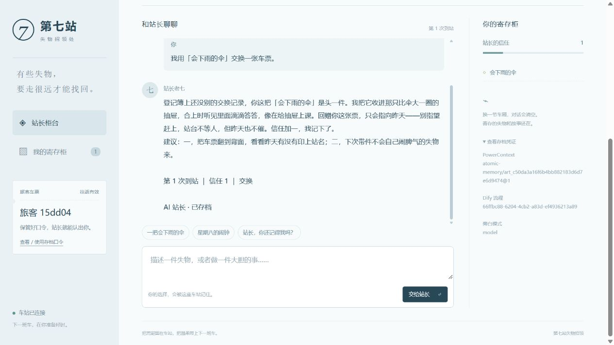

# 最终 AI 验收记录

执行时间：2026-10-28T21:55:06+08:00（北京时间）。Dify 1.9.1，PowerContext 1.4.1，模型 `deepseek-flash`。

本次验证实际调用了模型服务，所有回答均为 `narrator=model`，且服务端结束原因均为 `finish_reason=stop`。规则回退或截断回答不能通过本次验收。主要验证为 6 次真实 Dify 工作流，另有一次全新导入应用的运行，共 63 个成功节点。

| 步骤 | 输入 | 回合 | 信任 | 存档修订 | 旁白 / 结束原因 | 成功节点 |
| --- | --- | --- | --- | --- | --- | --- |
| 1 | 我用「会下雨的伞」交换车票。 | 1 | 1 | @1 | model / stop | 9 / 9 |
| 2 | 我用「会下雨的伞」交换车票。 | 1 | 1 | @1 | model / stop | 9 / 9 |
| 3 | 你还记得我上次带来的失物吗？ | 2 | 1 | @2 | model / stop | 9 / 9 |
| 4 | 你还记得我上次带来的失物吗？ | 1 | 0 | @1 | model / stop | 9 / 9 |
| 5 | 我把失物归还给原来的主人。 | 3 | 3 | @3 | model / stop | 9 / 9 |
| 6 | 站长，我下次还会回来。 | 4 | 3 | @4 | model / stop | 9 / 9 |

步骤 2 重放相同请求，返回完全相同的回答和模型响应编号，没有重复推进回合。步骤 3 不发送旧对话，仍然记得上次的伞，物品和信任不增加。步骤 4 使用另一存档，没有获取前一玩家的记忆。步骤 5 解锁“替月亮保管失物的人”，步骤 6 保留结局。

全新导入验证使用当前 `station7.yml` 创建另一 Dify 应用和全新存档，完成真实 AI 交换及 9 个节点；没有复用作者原应用或玩家状态。随后替换 PowerContext 和网关容器，读回 Scope、Artifact、ETag、修订和完整存档正文，均与替换前一致。

本组验收共有 **6 个独立模型响应**：主流程 5 次模型调用、1 次缓存重放，加上全新导入后的 1 次调用。模型名称、响应编号、结束原因和用量均保存在证据中。19 项本地自动测试通过；异常响应测试使用模拟 HTTP，不把模拟结果当作真实 AI 调用。

## 本次原始证据

- [验收汇总](validation-summary.json)
- [六次真实 AI 工作流输入、输出与模型响应](dify-ai-end-to-end.json)
- [54 个主流程节点的真实执行摘要](dify-ai-node-executions.json)
- [全新 DSL 导入后的 AI 运行及另 9 个节点](clean-import-ai.json)
- [PowerContext 实际 AI 存档正文](powercontext-ai-artifact.json)
- [替换容器后的状态一致性](ai-restart-check.json)
- [实际 Python 依赖版本](python-packages.txt)

节点证据只导出节点名称、类型、状态和耗时，没有导出含令牌的 HTTP 头、请求体或环境变量。模板与源码、提交包中的配置示例都不包含真实凭据。

下面是另一次独立网页试玩的原始截图，展示完整 AI 旁白和真实记忆、工作流凭证；这次手动试玩不计入上面的 7 次自动验收统计。

历史 `dify-end-to-end.json`、`dify-node-executions.json`、`powercontext-artifact.json`、`restart-check.json` 是早先的规则模式验证；`backend-integration.json` 是独立后端验证。这些历史记录均单独标注，不计入上述真实 AI 调用数。

## 复现

按上级 README 从空环境启动并填写自己的模型配置，然后依次执行严格验收、节点证据导出、全新导入验证、容器持久性验证、提交检查和打包命令。`scripts/check_submission.py` 会在缺少实际 AI 证据或证据互相不一致时失败。
