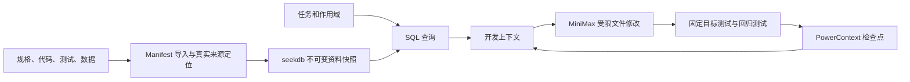

# 一页技术说明

本模块面向局部 SDD 开发任务，通过显式规格与工程作用域选择当前资料，保留可核对的版本和任务状态，并验证代码修改。验证工程为可独立运行的 Python 库存目录，任务是增加库存下限筛选并保持原行为。

**seekdb 的职责。** `pylibseekdb` 启动本地运行时，保存工程资料原文及索引元数据。导入器读取 manifest、规格 JSON 和 Python AST，生成文件、符号、真实行号、状态和哈希。新资料形成不可变快照，全部写入后切换项目当前指针。上下文由数据库 SQL 返回的数据直接组成，按任务作用域和 active 状态过滤，不用固定答案或文件系统检索替代数据库。退役规格保留历史但不进入当前上下文。

**PowerContext 的职责。** 使用 1.4.0 Core/Builtin SDK，将进度、待办和验证摘要保存为 Atomic Memory。项目及任务通过幂等键映射到持久 Scope；读写都使用公开 SDK，应用没有另外维护权威状态 JSON。后续 CLI 进程读取相同记录，准确引用随上下文输出。其 SQLite 存储与 seekdb 工程索引分工明确。

**MiniMax 的职责。** 当前规格、代码、测试及已恢复状态作为一次 HTTP 编辑请求的输入。本次由 `MiniMax-M3.1-Flash` 实际生成参数校验与库存筛选代码，21 项目标测试、8 项回归测试均通过。响应只允许写任务声明的业务代码文件，保存可见代码响应、请求和模型标识、输入快照、用量及耗时，不记录密钥或私有思维链。评审可重放交付的真实响应，无需再次调用模型。

**正确性与持续演进。** 文件变更后、重新导入前拒绝使用旧索引；重新导入后使用新内容。验证绑定资料快照和任务哈希，任一改变都会使旧结果过期。样例在修改前后使用同一组 21 项目标测试及 8 项回归测试，测试文件哈希必须一致。另有模块测试验证来源、作用域隔离、规格更新、状态恢复、过期判断和编辑边界。

**交付与限制。** CLI 提供 ingest/context/checkpoint/agent/verify，demo 从空环境连续验证独立进程恢复。材料包括前后快照、diff、命令、退出码、源哈希和三项技术记录。当前采用显式作用域选择，不包含向量检索或完整 Agent 会话恢复；适合可明确列出相关模块的局部修改任务。

